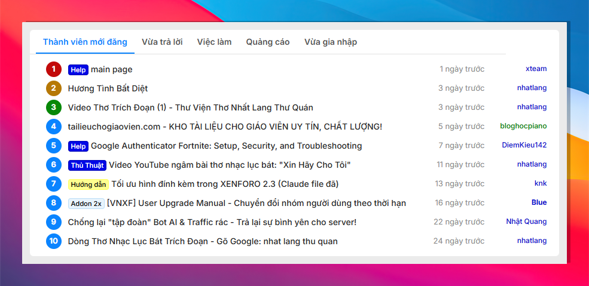
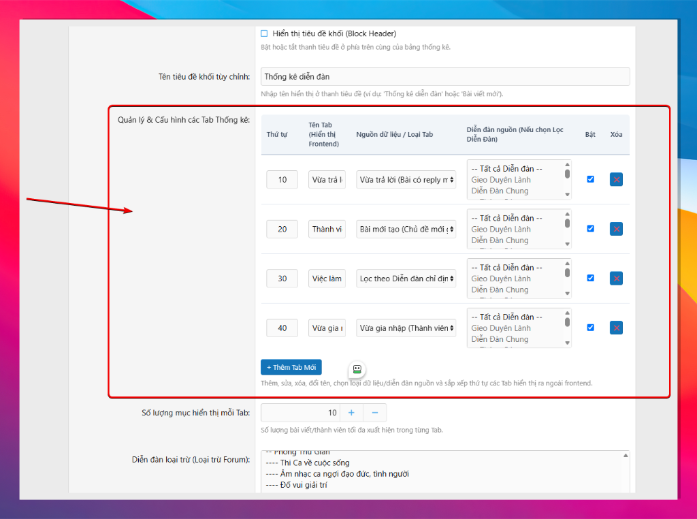
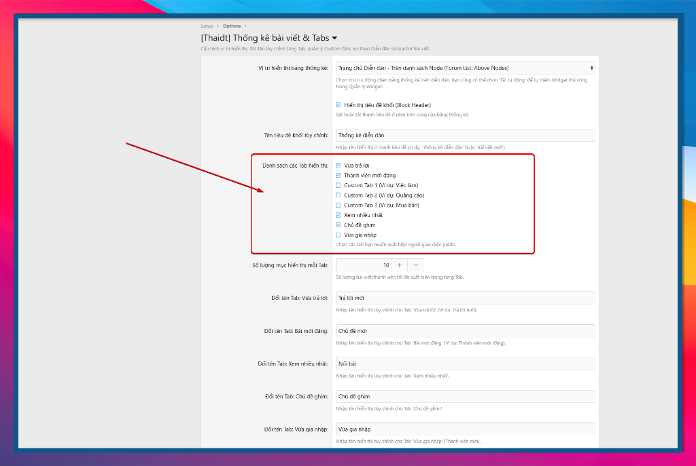
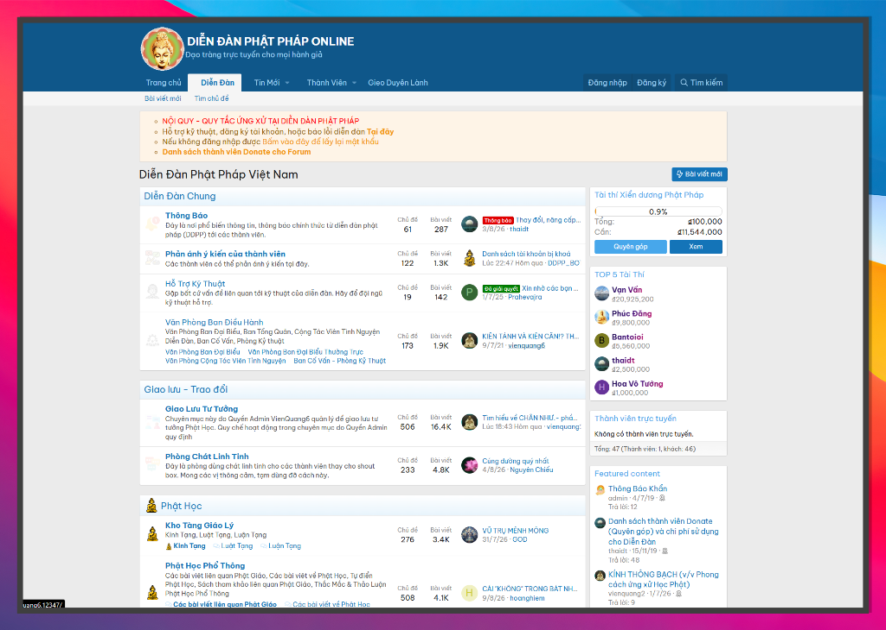

# 📊 [Thaidt] Recent Replies & Dynamic Tabs Statistics Add-on


**[Thaidt] Statistics** là một Add-on mạnh mẽ, hiện đại và tối ưu dành cho diễn đàn **XenForo 2.2 & 2.3**. Add-on giúp quản trị viên hiển thị **Bảng thống kê bài viết & thành viên đa tab (Multi-tab Statistics Block)** với giao diện phẳng UI/UX chuẩn chuyên nghiệp, hỗ trợ quản lý Tab động không giới hạn, lọc bài viết theo từng diễn đàn chuyên mục riêng và linh hoạt đặt ở mọi vị trí trên diễn đàn.

---

## 📑 Mục Lục (Table of Contents)

1. [🖼️ Demo Giao Diện (Screenshots)](#️-demo-giao-diện-screenshots)
2. [🔥 Tính Năng Nổi Bật (Key Features)](#-tính-năng-nổi-bật-key-features)
3. [💻 Yêu Cầu Hệ Thống (Requirements)](#-yêu-cầu-hệ-thống-requirements)
4. [🛠️ Hướng Dẫn Cài Đặt Từng Bước (Step-by-Step Installation)](#️-hướng-dẫn-cài-đặt-từng-bước-step-by-step-installation)
5. [⚙️ Hướng Dẫn Cấu Hình Từng Bước (Step-by-Step Configuration)](#️-hướng-dẫn-cấu-hình-từng-bước-step-by-step-configuration)
6. [💡 Hướng Dẫn Tạo Custom Tab Theo Diễn Đàn (Custom Tab Tutorial)](#-hướng-dẫn-tạo-custom-tab-theo-diễn-đàn-custom-tab-tutorial)
7. [📂 Cấu Trúc Thư Mục (Directory Structure)](#-cấu-trúc-thư-mục-directory-structure)
8. [❓ Câu Hỏi Thường Gặp (FAQ & Troubleshooting)](#-câu-hỏi-thường-gặp-faq--troubleshooting)
9. [📝 Giấy Phép (License)](#-giấy-phép-license)

---

## 🖼️ Demo Giao Diện (Screenshots)

### 1. Giao diện ngoài Frontend (Diễn đàn)
Bảng thống kê đa Tab hiển thị chuyên nghiệp với huy hiệu thứ hạng tròn màu sắc, tiền tố bài viết (Prefixes), tên tác giả Rich Color và thời gian tương đối:



---

### 2. Quản Lý Tab Động Trong Admin CP Options
Bảng quản lý Tab trực quan ngay trong **Admin CP -> Options**: Thêm Tab mới, xóa Tab, đổi tên, chọn nguồn dữ liệu, chọn diễn đàn nguồn và bật/tắt dễ dàng:



---

### 3. Trang Quản Lý Tabs Chuyên Dụng (Kéo - Thả Drag & Drop)
Hỗ trợ quản lý Tabs tại trang riêng **Setup -> [Thaidt] Quản lý Tabs Thống kê** với tính năng **Kéo - Thả (Drag & Drop)** đổi thứ tự hiển thị:



---

### 4. Tùy Chọn Vị Trí Hiển Thị Tự Động
Tùy chọn tự động hiển thị bảng thống kê ở các vị trí hot nhất trên diễn đàn:



---

## 🔥 Tính Năng Nổi Bật (Key Features)

### 🎨 1. Giao Diện Thống Kê Chuyên Nghiệp (Professional UI/UX)
- **Chuẩn Card UI**: Phẳng, hiện đại, tối ưu 100% Responsive trên Mobile, Tablet & Desktop.
- **Huy hiệu thứ hạng hình tròn (Circular Rank Badges)**:
  - 🥇 **Hạng 1**: Màu đỏ nổi bật (`#b71c1c`)
  - 🥈 **Hạng 2**: Màu vàng kim (`#b78103`)
  - 🥉 **Hạng 3**: Màu xanh lá (`#2e7d32`)
  - 🎖️ **Hạng 4+**: Màu xanh dương (`#1976d2`)
- **Tích hợp đầy đủ các thành phần XenForo**:
  - Tiền đề bài viết (**Thread Prefixes**).
  - Màu nhóm thành viên (**Rich Color Usernames**).
  - Avatar tác giả & thời gian đăng/trả lời tương đối (`X ngày trước`).
  - Chuyển Tab cực mượt bằng AJAX / JS không nạp lại trang.

### ⚡ 2. Quản Lý Tab Động Không Giới Hạn (Dynamic Tab Manager)
- ➕ **Thêm Tab Mới**: Tạo không giới hạn số lượng Tab.
- ✕ **Xóa Tab**: Loại bỏ Tab không muốn dùng.
- ✏️ **Đổi Tên Tab**: Tự do đặt tên hiển thị (*Vừa trả lời, Thành viên mới đăng, Việc làm, Mua bán rao vặt...*).
- ↕️ **Thứ Tự Hiển Thị**: Tự chọn thứ tự xuất hiện (`10, 20, 30...`).
- ☑️ **Bật / Tắt**: Công tắc Bật/Ẩn nhanh từng Tab.

### 🎯 3. Nguồn Dữ Liệu Đa Dạng (6 Data Sources)
1. 📌 **Vừa trả lời (`recent_replies`)**: Sắp xếp theo bài trả lời mới nhất (`last_post_date DESC`).
2. 🆕 **Bài mới tạo (`latest_threads`)**: Sắp xếp theo thời gian tạo chủ đề (`post_date DESC`).
3. 🔥 **Xem nhiều nhất (`most_viewed`)**: Sắp xếp theo số lượt xem (`view_count DESC`).
4. 📌 **Chủ đề ghim (`sticky`)**: Các chủ đề chú ý / ghim đầu diễn đàn.
5. 👤 **Vừa gia nhập (`new_members`)**: Thành viên mới đăng ký (hiển thị Avatar, Tên, Số bài).
6. 📂 **Lọc theo Diễn đàn chỉ định (`forum_nodes`)**: Nạp bài viết từ các chuyên mục cụ thể do Admin chọn.

---

## 💻 Yêu Cầu Hệ Thống (Requirements)

| Thành Phần | Yêu Cầu |
| :--- | :--- |
| **XenForo** | 2.2.x hoặc 2.3.x (Bao gồm XenForo 2.3.10+) |
| **PHP** | 7.4, 8.0, 8.1, 8.2, 8.3+ |
| **MySQL / MariaDB** | 5.7+ / 10.2+ |

---

## 🛠️ Hướng Dẫn Cài Đặt Từng Bước (Step-by-Step Installation)

### 🔹 Bước 1: Tải bộ mã nguồn lên Server
Giải nén và tải toàn bộ thư mục Add-on lên Server diễn đàn của bạn theo đúng đường dẫn:
```text
src/addons/Thaidt/Statistics/
```

### 🔹 Bước 2: Chạy Lệnh Cài Đặt
Mở Terminal / SSH tại thư mục gốc của diễn đàn XenForo và thực thi lệnh:
```bash
php cmd.php xf:addon-install Thaidt/Statistics
```

### 🔹 Bước 3: Rebuild Hoàn Thiện Dữ Liệu
Chạy lệnh Rebuild để khởi tạo bảng dữ liệu và menu quản trị:
```bash
php cmd.php xf:addon-rebuild Thaidt/Statistics
```

> **Cách khác (Cài qua Admin CP):** Bạn cũng có thể vào **Admin CP -> Add-ons** và nhấn nút **Install** tại mục `[Thaidt] Recent Replies Statistics`.

---

## ⚙️ Hướng Dẫn Cấu Hình Từng Bước (Step-by-Step Configuration)

### 🔹 Bước 1: Truy cập Trang Cài Đặt
Vào **Admin CP -> Setup -> Options -> [Thaidt] Thống kê bài viết & Vị trí**.

### 🔹 Bước 2: Chọn Vị Trí Hiển Thị Bảng Thống Kê
Tại ô **Vị trí hiển thị bảng thống kê**, chọn 1 trong các vị trí tự động:
- `Trang chủ Diễn đàn - Trên danh sách Node (Forum List: Above Nodes)` *(Khuyên dùng)*
- `Trang chủ Diễn đàn - Dưới danh sách Node (Forum List: Below Nodes)`
- `Trên thanh Breadcrumb đầu trang (Above Top Breadcrumb)`
- `Dưới thanh Breadcrumb đầu trang (Below Top Breadcrumb)`
- `Khu vực Header (Header / Above Main)`
- `Tắt tự động (Chỉ sử dụng qua Quản lý Widget thủ công)`

### 🔹 Bước 3: Quản Lý & Tùy Chỉnh Các Tab
Tại khối **Quản lý & Cấu hình các Tab Thống kê**:
1. Nhấn nút **`+ Thêm Tab Mới`** để tạo thêm dòng Tab.
2. Tại ô **Tên Tab (Hiển thị Frontend)**, nhập tên bạn muốn hiển thị ngoài trang chủ.
3. Tại ô **Nguồn dữ liệu / Loại Tab**, chọn loại nội dung tương ứng.
4. Nhấn nút **`✕`** nếu muốn xóa bỏ Tab.
5. Nhấn nút **Lưu** ở cuối trang để áp dụng toàn bộ cài đặt!

---

## 💡 Hướng Dẫn Tạo Custom Tab Theo Diễn Đàn (Custom Tab Tutorial)

Giả sử bạn muốn tạo một Tab tên **"Việc Làm"** chỉ hiển thị các bài viết thuộc diễn đàn *Tuyển Dụng & Việc Làm*:

1. Vào **Admin CP -> Setup -> Options -> [Thaidt] Thống kê bài viết & Vị trí**.
2. Nhấn nút **`+ Thêm Tab Mới`**.
3. Ô **Tên Tab**: Nhập `Việc Làm`.
4. Ô **Nguồn dữ liệu / Loại Tab**: Chọn `Lọc theo Diễn đàn chỉ định`.
5. Ô **Diễn đàn nguồn**: Giữ phím `Ctrl` (hoặc `Cmd` trên Mac) và chọn diễn đàn *Tuyển Dụng & Việc Làm*.
6. Ô **Thứ tự**: Nhập `30`.
7. Bấm **Lưu**. Out ngoài trang chủ bạn sẽ có ngay Tab "Việc Làm" hoạt động hoàn hảo!

---

## 📂 Cấu Trúc Thư Mục (Directory Structure)

```text
src/addons/Thaidt/Statistics/
├── Admin/
│   └── Controller/
│       └── TabController.php           # Admin CP CRUD & Drag-Drop Sorting Controller
├── Entity/
│   └── Tab.php                         # Tab Entity mapping bảng xf_thaidt_statistics_tab
├── Option/
│   └── TabManager.php                  # Option Callback Renderer cho Dynamic Tab Table
├── Repository/
│   └── TabRepository.php               # Repository nạp dữ liệu Tabs
├── Widget/
│   └── RecentReplies.php               # Frontend Widget Renderer chính
├── Setup.php                           # Khởi tạo bảng MySQL & Seeding dữ liệu ban đầu
├── addon.json                          # Thông tin khai báo Add-on
├── docs/
│   └── images/                         # Thư mục chứa hình ảnh hướng dẫn README
└── _data/
    ├── admin_navigation.xml            # Menu Admin CP
    ├── admin_routes.xml                # Định tuyến Admin CP
    ├── options.xml                     # Tùy chọn cài đặt hệ thống
    ├── phrases.xml                     # Cụm từ tiếng Việt / Việt hóa
    ├── templates.xml                   # Public LESS CSS & Admin Templates
    └── widget_definitions.xml          # Khai báo Widget XenForo
```

---

## ❓ Câu Hỏi Thường Gặp (FAQ & Troubleshooting)

### ❓ Tôi đã lưu cài đặt nhưng ngoài diễn đàn chưa hiện bảng thống kê?
👉 **Trả lời**: Bạn hãy kiểm tra xem mục **Vị trí hiển thị bảng thống kê** đã chọn đúng vị trí chưa (ví dụ chọn *Trang chủ Diễn đàn - Trên danh sách Node*). Nếu chọn *Tắt tự động*, bạn cần vào **Admin CP -> Appearance -> Widgets** để chèn Widget `[Thaidt] Thống kê bài viết & Tabs` thủ công.

### ❓ Sau khi sửa cài đặt hoặc rebuild bị báo lỗi cache?
👉 **Trả lời**: Mở Terminal và chạy lệnh xóa cache XenForo:
```bash
php cmd.php xf:rebuild-threads
```

---

## 📝 Giấy Phép (License)

Dự án được phát hành theo giấy phép **MIT License**. Bạn được tự do cài đặt, chỉnh sửa và chia sẻ cho cộng đồng XenForo.

---

<p center><i>Phát triển bởi <b>Thaidt</b> cho cộng đồng XenForo Việt Nam.</i></p>
